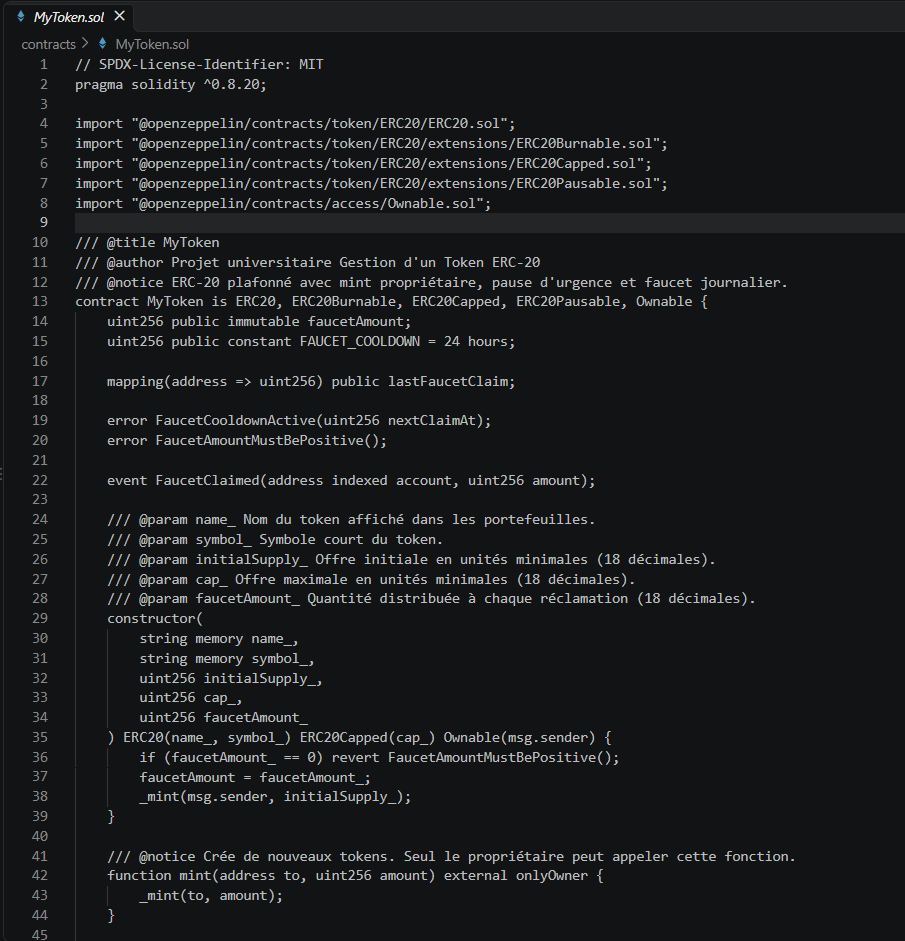

# Campus Token — ERC-20 sur Ethereum

Application pédagogique pour créer et gérer **CAMP**, un token ERC-20 déployé sur le testnet Sepolia. Le projet réunit un contrat Solidity, des scripts Hardhat et une interface web connectée à MetaMask.

## Aperçu


*Tableau de bord CAMP sur Sepolia ; l’adresse du portefeuille est masquée.*



*Le contrat `MyToken.sol` définit les règles du token et attribue l’offre initiale au déployeur.*

## Fonctionnalités

- Consulter le nom, le symbole, l’offre totale, le plafond et son solde CAMP.
- Envoyer des tokens avec `transfer` et gérer les autorisations avec `approve` / `transferFrom`.
- Réclamer des tokens au faucet une fois toutes les 24 heures par adresse.
- Détruire ses tokens avec `burn`.
- Réserver le mint et la mise en pause du contrat à son propriétaire.
- Déployer localement ou sur Sepolia et vérifier le contrat sur Etherscan.

Le contrat utilise OpenZeppelin ERC-20, Burnable, Capped, Pausable et Ownable. L’offre initiale est attribuée au compte qui déploie le contrat. Le plafond et la pause sont contrôlés dans le contrat lui-même.

## Technologies

Solidity 0.8.20 · Hardhat 2 · OpenZeppelin 5 · ethers.js 6 · Vite · MetaMask

## Organisation du code

```text
contracts/MyToken.sol       Contrat ERC-20 et règles du token
scripts/                    Déploiement et vérification
test/MyToken.test.js        Tests du contrat
frontend/                   Interface web Vite
  src/main.js               Connexion MetaMask et appels ethers.js
  src/contract.json         Adresse, réseau et ABI du contrat chargé par l’interface
hardhat.config.js           Configuration Solidity et réseaux Hardhat
.env.example                Modèle des paramètres locaux
```

## Contrat déjà déployé sur Sepolia

- Réseau : **Ethereum Sepolia** (chain ID `11155111`)
- Contrat : [`0xBF08AD6baE877dff8EbaFe89a78e51421Ea1cEf6`](https://sepolia.etherscan.io/address/0xBF08AD6baE877dff8EbaFe89a78e51421Ea1cEf6)
- Le fichier `frontend/src/contract.json` contient son adresse et son ABI pour l’interface.

Sepolia est un réseau de test. Les CAMP et ETH Sepolia n’ont pas de valeur sur Ethereum Mainnet.

## Prérequis

- Node.js LTS et npm
- MetaMask pour signer les actions de l’interface
- Pour déployer sur Sepolia : ETH Sepolia, un RPC Sepolia et une clé Etherscan

## Installer et lancer l’interface

À la racine du projet :

```bash
npm ci
npm ci --prefix frontend
npm run frontend
```

Vite affiche l’adresse locale, habituellement `http://localhost:5173`. Ouvrez-la dans le navigateur, connectez MetaMask et sélectionnez Sepolia pour utiliser le contrat déployé.

## Déployer en local

Ouvrez trois terminaux à la racine du projet :

```bash
npm run node
```

Dans un deuxième terminal, déployez sur le nœud local :

```bash
npm run deploy:local
```

Dans un troisième terminal, démarrez le frontend :

```bash
npm run frontend
```

Pour cette démo, ajoutez Hardhat Local dans MetaMask avec le RPC `http://127.0.0.1:8545` et le chain ID `31337`. Les comptes et clés affichés par Hardhat servent uniquement à la chaîne locale.

## Déployer sur Sepolia

1. Copiez `.env.example` en `.env` (`Copy-Item .env.example .env` dans PowerShell).
2. Renseignez `PRIVATE_KEY`, `SEPOLIA_RPC_URL` et `ETHERSCAN_API_KEY` dans `.env`. Utilisez un compte de test dédié.
3. Compilez puis déployez :

   ```bash
   npm run compile
   npm run deploy:sepolia
   ```

   Le script met à jour `frontend/src/contract.json` avec l’adresse, le réseau, le bloc de déploiement et l’ABI.

4. Vérifiez le contrat :

   ```bash
   npm run verify:sepolia
   ```

5. Lancez `npm run frontend`, puis connectez MetaMask à Sepolia.

## Commandes utiles

```bash
npm run compile         # compiler le contrat
npm test                # lancer les tests Hardhat
npm run coverage        # produire le rapport de couverture
npm run build:frontend  # construire le frontend pour production
```

## Sécurité

Ne partagez et ne commitez jamais `.env`, une clé privée ou une clé RPC privée. Le fichier `.env` est ignoré par Git. Les contrats et transactions déployés sur une blockchain sont publics ; utilisez uniquement des comptes et des fonds de test sur Sepolia.
